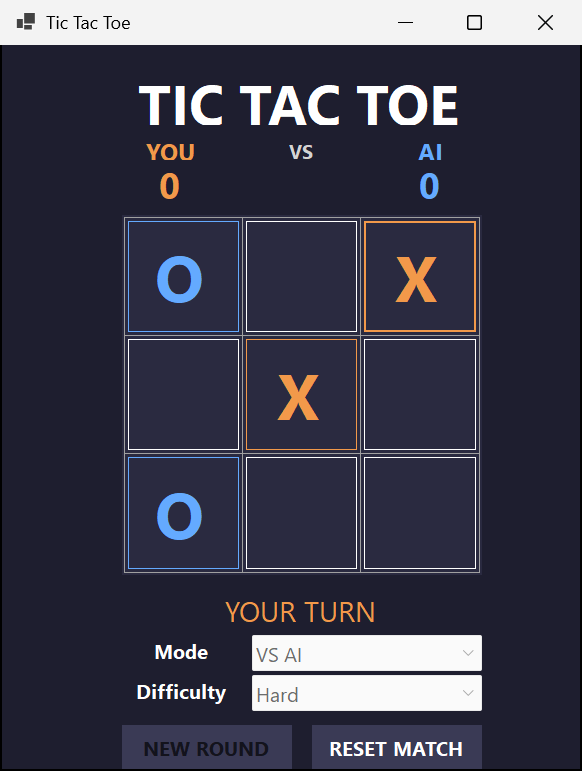
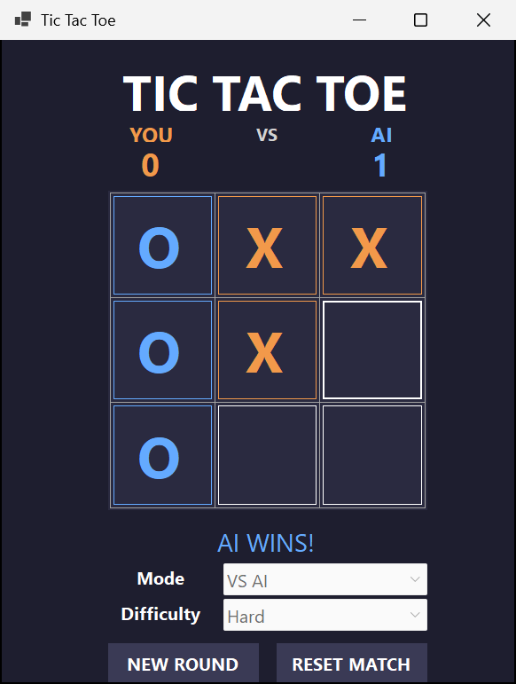

# Морски шах с изкуствен интелект

Игра „Морски шах“ (Tic-Tac-Toe) с графичен интерфейс, в която може да се играе срещу друг човек или срещу компютър на три нива на трудност. Проектът е курсова работа по програмиране на тема „Разработване и изследване на алгоритми за изкуствен интелект в играта „Морски шах““.

<p align="center">
  
  &nbsp;&nbsp;
  
</p>

## Възможности

- **Два режима** - двама играчи на един компютър (`1v1`) или игра срещу компютъра (`VS AI`).
- **Три нива на трудност** - Easy, Medium и Hard.
- **Рундове и резултат** - `NEW ROUND` започва нов рунд и запазва точките, `RESET MATCH` нулира всичко.
- **Редуване на началния играч** между рундовете.
- **Цвят за всеки играч** - X е оранжев, O е син; в същия цвят са името, резултатът и съобщението за хода.
- Режимът и трудността се **заключват след първия ход**, за да не могат да се сменят по средата на играта.

## Как играе компютърът

| Ниво | Клас | Как избира хода |
|---|---|---|
| Лесно | `RandomAi` | Случайна свободна клетка. |
| Средно | `MediumAi` | Печели, ако може с един ход; иначе блокира противника; иначе играе случайно. |
| Трудно | `HardAi` | Алгоритъм **Minimax** с **алфа-бета отсичане** - проверява всички продължения до края на играта. |

При трудното ниво оценката на победата е `10 - depth`, а на загубата `depth - 10`, така че компютърът печели възможно най-бързо. Алфа-бета отсичането пропуска клоновете, които така или иначе няма да бъдат избрани - ходът остава същият, но се проверяват много по-малко позиции.

## Резултати от изследването

Проектът `Experiment` пуска много игри автоматично и сравнява трите нива (процентите са от гледна точка на компютъра и леко се различават при всяко пускане):

| Ниво | Противник | Победи | Равни | Загуби |
|---|---|---:|---:|---:|
| Лесно | случаен | 42,0% | 13,4% | 44,6% |
| Средно | случаен | 80,0% | 16,5% | 3,5% |
| Трудно | случаен | 90,2% | 9,8% | 0% |
| Лесно | перфектен | 0% | 10,0% | 90,0% |
| Средно | перфектен | 0% | 46,5% | 53,5% |
| Трудно | перфектен | 0% | 100% | 0% |

Алфа-бета отсичането намалява броя на проверените позиции при първия ход на празно поле от **549 945** на **20 865** (около 26 пъти), без да променя избрания ход.

## Структура на проекта

```
TicTacToeAI/
├── TicTacToeAI.slnx            решението за Visual Studio
├── TicTacToeAI/                играта (Windows Forms)
│   ├── Form1.cs                прозорецът, бутоните и резултатът
│   ├── Form1.Designer.cs       разположението на елементите
│   ├── Program.cs              входната точка
│   └── GameLogic/
│       ├── Board.cs            игровото поле и правилата
│       ├── RandomAi.cs         лесно ниво
│       ├── MediumAi.cs         средно ниво
│       └── HardAi.cs           трудно ниво (Minimax + алфа-бета)
├── Experiment/                 конзолна програма за сравнение на нивата
│   └── Program.cs
└── docs/                       екранни снимки
```

Логиката на играта (`GameLogic`) е отделена от интерфейса (`Form1`): формата само пита избраното ниво за ход чрез `GetMove()`, а правилата се проверяват в `Board`.

## Как да се стартира

Нужни са **Windows** и **.NET 10 SDK** (или Visual Studio с поддръжка на .NET 10).

**Играта** - отворете `TicTacToeAI.slnx` във Visual Studio и натиснете F5, или от терминал:

```bash
dotnet run --project TicTacToeAI
```

**Експериментът** - във Visual Studio изберете `Experiment` като Startup Project, или от терминал:

```bash
dotnet run --project Experiment -c Release
```

## Използвани технологии

- C# и .NET 10
- Windows Forms
- Visual Studio
